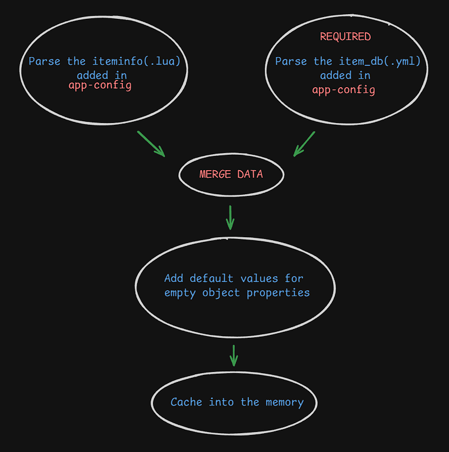

# Item Database

## Overview
The Item Database combines data from two main sources -
- rAthena's item database for server data parsing
- The client's iteminfo.lua mainly for the image and description for the frontend


## Helper Functions
### getItemInfo(id)
Retrieves complete item information from the database.

**Parameters:**
- `id` (number): Item ID

**Usage:**
```js
import { getItemInfo } from "@/utils/item";

const item = await getItemInfo(501);
if (item) {
  console.log(item.Name);    // "Red Potion"
  console.log(item.Buy);     // 50
  console.log(item.Weight);  // 70
  console.log(item.Description); // Description in iteminfo if provided
}
```

**Returns:**
- `Promise<ItemDatabaseFormat | null>`: Item data object or null if not found

**Return Parameters:**
- [rAthena Item DB Structure](https://github.com/rathena/rathena/blob/master/doc/item_db.txt)
- `Description`: The description in iteminfo
- `Image`: The resource name in iteminfo

---
### getTradeRestrictions(id)
Returns the restriction as an array of string of the provided `Id`. <br>It will return `No Restriction` by default when there's no trade restriction.

**Parameters:**
- `id` (number): Item ID

**Usage:**
```js
import { getTradeRestrictions } from "@/utils/item";

const restriction = getTradeRestrictions(24318);

restriction.map(item => console.log(item));

Outputs:
No Drop
No Sell
No Auction
```

## Parsing Flow

